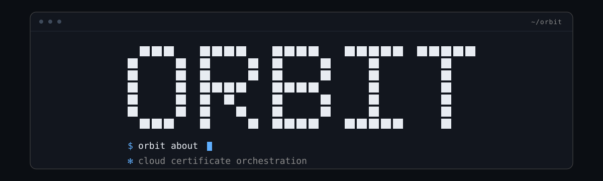

<div align="center">



**Match certificates to your domains, apply them, and retire the leftovers — from the terminal.**

[](go.mod)
[](docs/TENCENT_API_NOTES.md)
[](https://github.com/charmbracelet/bubbletea)
[](locales)
[](docs/IMPLEMENTATION_PLAN.md)
[](https://github.com/Nimatattic/Orbit/actions/workflows/ci.yml)

[](https://github.com/Nimatattic/Orbit/stargazers)
[](https://github.com/Nimatattic/Orbit/commits/main)
[](https://github.com/Nimatattic/Orbit/issues)

[Quick start](#quick-start) · [Install](#installation) · **[Usage docs](docs/usage/README.md)** · [Operations](docs/OPERATIONS.md)

</div>

---

## Why Orbit

Most teams already automate the *easy* half of certificate management: ACME issues the
certificate and something pushes it to the cloud. What is left is the part nobody wants to
script — **pointing the right certificate at the right domain, and deleting the ones that no
longer serve anything.**

Orbit fills that gap. It reads the certificate pool and the live domain inventory, decides
per domain which certificate *should* be bound, applies it, verifies the change came back
from the cloud, and — separately, behind four gates — removes certificates that no cloud
resource references any more. It also manages the DNS records those certificates depend on.

```text
1Panel / ACME ──▶ local dir ──▶ upload to cloud ──▶ ┌─────────────────────┐
                                                    │ apply to domains    │ ◀── Orbit
                                                    │ delete orphans      │ ◀── Orbit
                                                    │ manage DNS records  │ ◀── Orbit
                                                    └─────────────────────┘
```

Orbit stops at the dotted line: it does not issue certificates and does not read `tccli`
credentials. It is the missing step in *your* pipeline, not another CA client.

## Features

| | |
| --- | --- |
| **RFC 6125 matching** | Exact SANs, single-label wildcards, validity-aware ranking, deterministic tie-breaking. |
| **Idempotent plans** | `update` plans first; domains already holding the best certificate are never written twice. |
| **Product-aware writes** | CDN partial config update, EdgeOne `sslcert` mode; groups run concurrently, results stay ordered. |
| **Read-back verification** | Every write is confirmed by polling the product. A timeout is `unverified`, never a silent success. |
| **Gated deletion** | Uploaded by you · superseded · beyond the grace period · referenced by nothing. Evidence must be complete. |
| **Backup before delete** | Certificate, chain and private key (`0600`) plus metadata, written before the API call. |
| **Audit log** | Append-only JSONL, one record per change plus a run summary. Never contains credentials. |
| **DNS management** | Zones and records: list, idempotent `set`, delete, enable/disable, propagation check. CLI and TUI. |
| **Two interfaces** | Full-screen TUI for humans, exit codes and `--json` for cron. |
| **One static binary** | `CGO_ENABLED=0`, no runtime dependencies, English and 简体中文 at parity. |

## Quick start

No cloud account, no credentials, no network — the demo provider is fully offline:

```bash
git clone https://github.com/Nimatattic/Orbit.git
cd Orbit
make build

./bin/orbit --demo status                 # inventory + plan, read-only
./bin/orbit --demo update --ssl --dry-run # what would be applied, and why
./bin/orbit --demo dns ls example.com     # DNS records
./bin/orbit --demo dash                   # the interactive console
```

Then follow **[getting started](docs/usage/getting-started.md)** to register an account and
run against the real cloud.

## Installation

Every release ships **9 static packages** (no runtime dependencies, `CGO_ENABLED=0`), each
containing a flat `orbit` + `LICENSE` + `README.md`, plus one checksum file:

| Target | Package |
| --- | --- |
| linux / amd64 | `orbit_<version>_linux_amd64.tar.gz` |
| linux / arm64 | `orbit_<version>_linux_arm64.tar.gz` |
| linux / armv7 | `orbit_<version>_linux_armv7.tar.gz` |
| linux / 386 | `orbit_<version>_linux_386.tar.gz` |
| darwin / amd64 | `orbit_<version>_darwin_amd64.tar.gz` |
| darwin / arm64 | `orbit_<version>_darwin_arm64.tar.gz` |
| windows / amd64 | `orbit_<version>_windows_amd64.zip` |
| windows / arm64 | `orbit_<version>_windows_arm64.zip` |
| freebsd / amd64 | `orbit_<version>_freebsd_amd64.tar.gz` |
| checksums | `orbit_<version>_checksums.txt` (sha256, 9 lines) |

`<version>` is the release tag (a build without a tag is named `v0.1.0-dev`).

Download, verify, install — `<version>` and the platform pair are the only things to change:

```bash
VERSION=v1.2.3
base="https://github.com/Nimatattic/Orbit/releases/download/${VERSION}"

curl -LO "${base}/orbit_${VERSION}_linux_amd64.tar.gz"
curl -LO "${base}/orbit_${VERSION}_checksums.txt"

sha256sum -c --ignore-missing "orbit_${VERSION}_checksums.txt"   # -> ...: OK
tar -xzf "orbit_${VERSION}_linux_amd64.tar.gz"                   # flat: orbit, LICENSE, README.md

install -m 0755 orbit /usr/local/bin/orbit
orbit version
```

`--ignore-missing` only checks the packages you actually downloaded; after a local
`make dist` in a full `dist/` directory, drop it to verify all 9 at once:

```bash
cd dist && sha256sum -c "orbit_${VERSION}_checksums.txt"
```

### From source

```bash
git clone https://github.com/Nimatattic/Orbit.git
cd Orbit
make build && make install    # -> bin/orbit, then /usr/local/bin/orbit (Go 1.27+)
```

### Build the release packages yourself

```bash
make dist        # = bash scripts/build-dist.sh --all -> 9 packages + checksums in dist/
make release     # compatibility alias for make dist (same script, same artifacts)
```

`make dist` and `make release` are exactly equivalent: `release` is the historical name,
kept so existing scripts keep working. Both delegate to
[`scripts/build-dist.sh`](scripts/build-dist.sh), the single source of truth that CI also
calls — so a local build and a published release are produced by the same code.

Full instructions, including `go install`:
[getting-started.md](docs/usage/getting-started.md#1-install).

## Usage

All usage documentation lives in **[`docs/usage/`](docs/usage/README.md)**. This README
stays an overview; every command, flag and workflow is documented there.

| Topic | Document |
| --- | --- |
| Install, first account, demo mode | [getting-started.md](docs/usage/getting-started.md) |
| Dry-run vs `--yes`, TUI vs text, exit codes | [modes.md](docs/usage/modes.md) |
| Every command and flag | [commands.md](docs/usage/commands.md) |
| Matching, applying, cleanup gates, backups | [certificates.md](docs/usage/certificates.md) |
| DNS zones and records, propagation checks | [dns.md](docs/usage/dns.md) |
| Interactive screens and keys | [tui.md](docs/usage/tui.md) |
| Credentials, rotation, account selection | [accounts.md](docs/usage/accounts.md) |
| CAM permissions and policy generation | [permissions.md](docs/usage/permissions.md) |
| Configuration files and keys | [configuration.md](docs/usage/configuration.md) |
| Errors, surprises and fixes | [troubleshooting.md](docs/usage/troubleshooting.md) |

The three most common commands:

```bash
orbit status                      # what is here, what needs doing (TUI on a terminal)
orbit update --ssl --dry-run      # plan; add --yes to apply
orbit clean --ssl --older-than=7d # candidates and the reason for every skip
```

## How to Dev

```bash
source ../.toolchains/env.sh     # if you use the workspace-managed toolchain
make build                       # bin/orbit
make test                        # full suite, fully offline
make vet                         # go vet
make check                       # fmt check + vet + test, exactly what CI runs
make lint                        # vet + golangci-lint when installed
make dist                        # 9 packages + checksums into dist/ (make release is the alias)
```

The test suite never touches the network: the cloud is reached through narrow
`sslAPI` / `cdnAPI` / `teoAPI` / `dnspodAPI` / `stsAPI` interfaces that tests implement with
fakes — pagination, retries, half-open poll loops, permission errors. TUI screens are
Bubble Tea models, so their state machines are unit-tested without a terminal.

| Package | Covered |
| --- | --- |
| `internal/core` | Matching, ranking, plans, cleanup gates, DNS validation |
| `internal/cloud/tencent` | SDK interaction, error mapping, permission table, policies |
| `internal/render/tui` | Model state machines, layout geometry (CJK widths included) |
| `internal/cli` | Flags, mode selection, output formats, backups, audit |
| `internal/config`, `internal/credential`, `internal/i18n` | Merge precedence, secret storage, catalogue parity |

The README poster is generated from the same bitmap the CLI draws:

```bash
python3 scripts/gen-banner.py     # rewrites assets/banner.svg
```

`TestAboutLogoMatchesBanner` renders the SVG back into a bitmap and fails if it ever
disagrees with `orbit about`.

## Structure

```text
cmd/orbit/                 entry point (thin main)
internal/
  cli/                     commands, flags, mode selection, output, about card
  core/                    pure domain logic: model, matching, plan, safety gates, DNS rules
  cloud/                   Provider interface + offline demo provider
    fake/                  the --demo fixture
    tencent/               Tencent Cloud: SSL, CDN, EdgeOne, DNSPod, STS; permissions
  render/
    plain/                 text output for scripts
    tui/                   Bubble Tea screens: console, status, run, guide, DNS, picker
  audit/                   append-only JSONL run log
  config/                  layered config, paths, defaults
  credential/              secret storage (0600) and resolution
  i18n/                    bundle + locale negotiation (en-US, zh-CN)
  exitcode/                exit-code contract and error wrapping
  tty/  version/           terminal detection, build metadata
assets/                    banner poster (SVG, pixel wordmark)
docs/usage/                user documentation (installation, commands, TUI, DNS, …)
docs/                      operations, design, API notes, verification, CAM policies
locales/                   embedded message catalogues (key parity enforced by test)
scripts/                   build-dist.sh (release matrix), cron / systemd examples, banner generator
testdata/                  fixtures
```

## Documentation

| Document | What it covers |
| --- | --- |
| **[docs/usage/](docs/usage/README.md)** | **All usage: install, commands, TUI, DNS, permissions, config, troubleshooting** |
| [docs/OPERATIONS.md](docs/OPERATIONS.md) | Deployment: install, cron/systemd, audit queries, rollback, upgrades, CI and release artifacts |
| [docs/IMPLEMENTATION_PLAN.md](docs/IMPLEMENTATION_PLAN.md) | Architecture, milestones, interface inventory |
| [docs/TENCENT_API_NOTES.md](docs/TENCENT_API_NOTES.md) | Verified cloud behaviour and every open question |
| [docs/VERIFY_M1.md](docs/VERIFY_M1.md) | Step-by-step verification against a real account |
| [DECISIONS.md](DECISIONS.md) | Decision log: every non-obvious choice and its reason |

## Roadmap

- [x] **M0–M2** — skeleton, read-only inventory against a real account, matching engine
- [x] **M3–M4** — apply with read-back verification, gated cleanup with backups and audit
- [x] **M5** — TUI: overview, per-account console, permission guide
- [x] **M6** — static releases, operations manual, CAM templates, `orbit about`
- [x] **DNS** — zones and records over CLI and TUI
- [ ] Additional providers (Alibaba Cloud, AWS)
- [ ] Per-domain certificate pairs (RSA + SM2) instead of a single binding
- [ ] `orbit restore` — re-upload a certificate straight from `~/.orbit/backups`
- [x] CI (vet + tests + 9-platform release packages)
- [ ] GPG-signed tags and releases (maintainer, manual)

## Contributing

Issues and pull requests are welcome. Before opening one:

1. `make build && make test && make vet` must pass.
2. Keep the layering: pure logic in `internal/core`, cloud specifics in `internal/cloud`,
   presentation in `internal/render`.
3. If you touch a cloud API, update the permission table — a test reflects over the SDK
   interfaces and reports exactly which action is undocumented.
4. If you change user-visible text, add the key to **both** locales; parity is enforced.
5. Prefer a test over a comment. The suite is offline and fast.

## Security

- No credentials, tokens or private keys are stored in this repository.
- `~/.orbit/credentials.yaml` must be `0600`; Orbit refuses to start otherwise.
- Audit records never contain secrets — only identifiers and outcomes.
- Report vulnerabilities privately via GitHub **Security → Report a vulnerability**.

## License

[MIT](LICENSE) © 2026 Nimatattic.

Use, modify and redistribute it freely, including commercially; keep the copyright notice
and the permission notice. The software ships without warranty of any kind. See
[`LICENSE`](LICENSE) for the binding text.

## Star History

<a href="https://star-history.com/#Nimatattic/Orbit&Date">
  <picture>
    <source media="(prefers-color-scheme: dark)" srcset="https://api.star-history.com/svg?repos=Nimatattic/Orbit&type=Date&theme=dark" />
    <source media="(prefers-color-scheme: light)" srcset="https://api.star-history.com/svg?repos=Nimatattic/Orbit&type=Date" />
    
  </picture>
</a>

## Acknowledgements

- [Tencent Cloud SDK for Go](https://github.com/TencentCloud/tencentcloud-sdk-go) — the API surface Orbit drives
- [Charm](https://charm.sh) — [Bubble Tea](https://github.com/charmbracelet/bubbletea), [Bubbles](https://github.com/charmbracelet/bubbles), [Lip Gloss](https://github.com/charmbracelet/lipgloss)
- [Cobra](https://github.com/spf13/cobra) — command structure
- [1Panel](https://1panel.cn) — the certificate workflow that motivated this tool

<div align="center">
<sub>Built with Go. Ships as one static binary. Never touches a credential it did not store itself.</sub>
</div>
